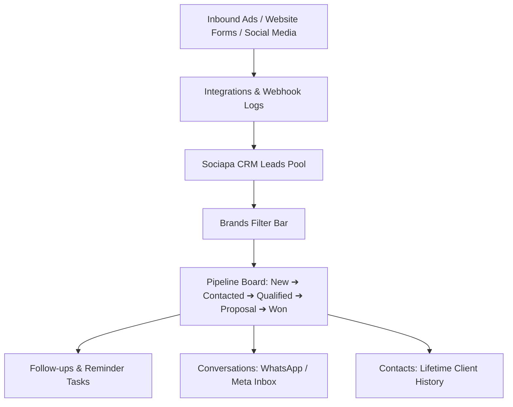

# 📘 Sociapa CRM — Sidebar Navigation & Feature Guide

Yeh document **Sociapa CRM (Lead Management System)** ke sidebar ke sabhi options, links aur modules ki complete functional guide hai. Isme har ek link ka matlab, uska working process aur real-world use-case detail mein explain kiya gaya hai.

---

## 🧭 System Architecture & Flow

Sociapa CRM multi-brand agency operations ko dhyan mein rakh kar design kiya gaya hai. Yahan Sociapa ke sabhi sub-brands (Sociapa Main, Brand Studio, News, Influencer, etc.) ki incoming leads, client inquiries, follow-ups aur campaigns ek hi jagah manage hote hain.

---

## 1. 🏷️ BRANDS Switcher (Top Filter Bar)

### 📌 Iska Matlab Kya Hai?
Sidebar ke sabse upar jo pills dikh rahe hain (`All`, `Sociapa`, `Sociapa Brand Studio`, `Sociapa News`, `Sociapa Influencer`, `testing`), yeh **Multi-Brand Workspace Switcher** hain.

### ⚙️ Kaise Work Karta Hai?
- Jab aap kisi brand pill par click karte hain (jaise **Sociapa Brand Studio**):
  - **Pura CRM instantly filter ho jata hai**: Dashboard stats, Leads ki list, Pipeline board aur Follow-ups sirf usi selected brand ke display hote hain.
  - Dusre brands ka data temporary hide ho jata hai taaki confusion na ho.
- **`All` Pill**: Sabhi brands ka combined data ek sath dekhne ke liye use hota hai.

### 💼 Real-World Use Case:
Sociapa ke multiple business verticals hain (Design Studio, News, Influencer marketing, Main Agency). Is filter se har vertical ka team lead ya manager sirf apna relevant data dekh sakta hai bina doosre brands ke mix hue.

---

## 2. ➕ [+ New Lead] Button (Primary Red CTA)

### 📌 Iska Matlab Kya Hai?
Yeh **Direct Manual Lead Creation** ka shortcut action button hai.

### ⚙️ Kaise Work Karta Hai?
- Is par click karte hi ek clean modal/form open hota hai jisme:
  - **Client Details**: Name, Phone, Email, Company
  - **Brand Selection**: Lead kis brand ke under aayi hai (Sociapa, Brand Studio, etc.)
  - **Lead Source**: Phone Call, Referral, Event, WhatsApp, Direct Walk-in
  - **Estimated Deal Value**: Client ka tentative budget (INR / Currency)
  - **Initial Stage**: Normally "New" ya "Contacted"
  - **Notes**: Pehli meeting ya call ki summary
- Submit karte hi backend automatic duplicate check karta hai (same email/phone) aur lead instantly database aur pipeline mein create ho jati hai.

### 💼 Real-World Use Case:
Agar kisi client ne sales executive ko direct call kiya ya WhatsApp par inquiry bheji (jo website ke automated form se nahi aayi), to executive turant `+ New Lead` click karke entry kar leta hai taaki inquiry miss na ho.

---

## 3. 📂 MAIN Section

### 📊 3.1. Dashboard
- **Matlab**: CRM ka primary control room aur analytical summary page.
- **Kaise Work Karta Hai**:
  - Real-time KPI cards: Total Leads, Today's Inquiries, Conversion Rate %, Total Pipeline Value.
  - Visual charts: Leads by Brand distribution, Leads by Source (Google, Facebook, Website, Referral).
  - Recent activity stream (kaun si lead kis stage mein move hui, kisne naya note add kiya).
- **Use Case**: Management aur team leads roz subah Dashboard dekh kar overall marketing aur sales velocity analyze karte hain.

### 🏢 3.2. Brands
- **Matlab**: Agency ke sabhi sub-brands aur business units ka configuration center.
- **Kaise Work Karta Hai**:
  - Naya brand add karna (Name, Brand Logo, Brand Color, Slug).
  - **API Keys & Webhook Secret**: Har brand ki apni unique API key hoti hai jisse us specific brand ki website ko CRM se connect kiya jata hai.
- **Use Case**: Agar Sociapa kal ko naya vertical launch karti hai (e.g. "Sociapa Tech"), to Admin yahan se 1 minute mein naya brand configure kar sakta hai.

### 👥 3.3. Leads (Counter Badge: 31)
- **Matlab**: CRM ka core central database jahan har ek client inquiry row-by-row stored hoti hai.
- **Badge '31' ka Matlab**: System mein filhal active/unresolved ya total 31 leads maujood hain.
- **Kaise Work Karta Hai**:
  - Advance filter aur search bar: Search by Name, Phone, Email, Date Range, Status.
  - Bulk actions: Leads ko select karke CSV/Excel mein export karna ya bulk delete/assign karna.
  - Har lead row par click karke **Lead Detail View** khulta hai jahan:
    - Calling notes aur timeline history hoti hai.
    - Status/Stage dropdown change kiya ja sakta hai.
    - Client ko call/WhatsApp karne ka direct action hota hai.
- **Use Case**: Daily routine mein sales executives isi list ko filter karke leads ko dial karte hain aur updates daalte hain.

### 📇 3.4. Contacts
- **Matlab**: Long-term Client & Individual People Directory.
- **Difference (Lead vs Contact)**:
  - *Lead*: Temporary inquiry hoti hai jo close (Won) ya cancel (Lost) ho sakti hai.
  - *Contact*: Ek permanent person/client profile hoti hai. Ek single Contact bhavishya mein multiple leads create kar sakta hai (repeat projects).
- **Kaise Work Karta Hai**:
  - Har contact ke under unka email, mobile, company, job title aur unke dwara ki gayi saari past deals ki history link hoti hai.
- **Use Case**: Agar koi purana client 1 saal baad dubara call karta hai, to Contacts mein unka number search karte hi unka pura past record mil jata hai.

---

## 4. 💬 COMMUNICATIONS Section

### 📥 4.1. Conversations
- **Matlab**: Unified Multi-Channel Customer Inbox (Omnichannel Messaging).
- **Kaise Work Karta Hai**:
  - Jab client Meta Ads (Facebook/Instagram DM) ya WhatsApp Business API ke zariye inquiry karta hai, to saare incoming messages is single window mein real-time aate hain.
  - Team yahan se bina WhatsApp Web ya Meta Business Suite alag se khole direct customer ko reply de sakti hai.
  - Chat status track hota hai (Open, Pending, Resolved).
- **Use Case**: Multiple social platforms par aane wale customer messages ko ek hi screen par respond karna taaki koi response time delay na ho.

---

## 5. 📢 MARKETING Section

### 🎯 5.1. Campaigns
- **Matlab**: Paid Ads & Marketing Campaigns Manager.
- **Kaise Work Karta Hai**:
  - Marketing campaign setup: Name (e.g., "Brand Awareness Q4"), Source (Google/Meta), Start & End Date, Ad Budget, Target Leads.
  - CRM automatic calculate karta hai: Actual Leads vs Target Leads, Cost Per Lead (CPL), aur Total Closed Revenue.
- **Use Case**: Marketing team check karti hai ki unka jo ₹50,000 ka ad budget laga tha, usme kitni qualified leads aayi aur ROI positive raha ya nahi.

### 🎯 5.2. Ad Sources
- **Matlab**: Lead generation platforms aur traffic origins ka tracking center.
- **Kaise Work Karta Hai**:
  - Tracks channels: Facebook Ads, Instagram Ads, Google Search, LinkedIn, Website Direct, Organic SEO.
  - UTM tags mapping (`utm_source`, `utm_medium`, `utm_campaign`) aur Ad Account IDs store karta hai.
  - Active/Inactive toggle switch se sources manage kiye ja sakte hain.
- **Use Case**: Pata lagana ki Sociapa ke liye sabse zyada convert hone wali leads Instagram se aa rahi hain ya Google Ads se.

### 📋 5.3. Lead Forms
- **Matlab**: Inquiry Form Builder & Website Embed Manager.
- **Kaise Work Karta Hai**:
  - Yahan se custom forms banaye jate hain (Fields: Name, Phone, Email, Service Needed, Message).
  - Har form ka ek unique public slug, embed code ya webhook endpoint milta hai.
  - Form submit hone par custom "Thank You" message ya redirection URL set kiya jata hai.
  - Admin notification email configure hoti hai.
- **Use Case**: Jab Sociapa ki website par koi naya landing page banta hai (e.g. SEO services ya Packaging Design), to us page ka inquiry form is tool se banaya ya link kiya jata hai.

---

## 6. 🔄 PIPELINE Section

### 📋 6.1. Pipeline Board
- **Matlab**: Visual Kanban Sales Funnel (Drag-and-Drop Board).
- **Kaise Work Karta Hai**:
  - Har lead ek visual card ke form mein columns mein dikhai deti hai:
    1. **New**: Fresh aayi hui inquiry jo abhi touch nahi hui.
    2. **Contacted**: Pehli call ya email bheja ja chuka hai.
    3. **Qualified**: Client ki requirement aur budget agency ke suitable hai.
    4. **Proposal**: Client ko quotation / pitch deck bhej diya gaya hai.
    5. **Negotiation**: Price aur terms par discussion chal raha hai.
    6. **Won (Green)**: Deal close ho gayi, client onboard ho gaya!
    7. **Lost (Red)**: Deal cancel ho gayi (with reason, e.g., low budget).
  - Cards ko mouse se drag karke next stage mein drop kiya jata hai.
- **Use Case**: Management ki weekly sales review meetings mein pure team ka visual pipeline inspect karne ke liye sabse effective view hai.

### ⏰ 6.2. Follow-ups (Counter Badge: 32)
- **Matlab**: Sales Task Reminders & Follow-up Scheduler.
- **Badge '32' ka Matlab**: System mein 32 tasks/calls pending ya scheduled hain.
- **Kaise Work Karta Hai**:
  - 3 dynamic tabs hote hain:
    - 🔴 **Overdue**: Jinki due date nikal chuki hai par call nahi hua (High Priority).
    - 🟡 **Due Today**: Jo aaj execute karne hain.
    - 🟢 **Upcoming**: Bhavishya ke scheduled follow-ups.
  - Call complete hone par executive "Mark Complete" par click karta hai aur agle follow-up ki date set kar deta hai.
- **Use Case**: Koi bhi sales team bina follow-up system ke leads close nahi kar sakti. Yeh module ensure karta hai ki ek bhi lead bhooli na jaye.

---

## 7. 🔌 INTEGRATIONS Section

### ⚡ 7.1. Integrations
- **Matlab**: External software, ad networks aur website APIs ke connectors.
- **Kaise Work Karta Hai**:
  - **Website API**: Sociapa ki official websites ke forms ko connect karta hai.
  - **Facebook / Meta Lead Ads**: Facebook ke instant forms ko directly CRM se bind karta hai.
  - **Instagram Direct**: Instagram lead generation forms aur DMs ko connect karta hai.
  - **WhatsApp Business API**: Direct messaging integration.
  - API keys, access tokens aur mapping field settings yahan configure hoti hain.
- **Use Case**: Facebook par jaise hi koi user ad form submit kare, lead bina 1 second delay ke CRM mein auto-create ho jaye.

### 📜 7.2. Webhook Logs
- **Matlab**: Technical audit trail aur real-time data incoming log.
- **Kaise Work Karta Hai**:
  - Jab bhi external site ya Facebook ad se koi data CRM par aata hai:
    - Raw JSON payload record hota hai.
    - HTTP Status record hota hai (200 OK, 422 Validation Error, 500 Failure).
  - Agar network fail hone par lead create nahi hui, to developer yahan se **Retry** button daba kar us lead ko manually process kar sakta hai.
- **Use Case**: Troubleshooting ke liye: Jab developer ko dekhna ho ki website se aane wala lead payload kaisa dikh raha hai aur kyun koi entry miss hui.

---

## 8. ⚙️ SYSTEM & AUTH Section

### 🛠️ 8.1. Settings
- **Matlab**: Global Administrator Configurations.
- **Kaise Work Karta Hai**:
  - Admin Profile settings (Name, Email update).
  - Security (Change Password).
  - System-wide email alerts aur brand API key regeneration.
- **Use Case**: Account security aur global preferences adjust karne ke liye.

### 👤 8.2. Sociapa Admin / Sign Out
- **Matlab**: Currently logged-in user identification aur secure logout.
- **Kaise Work Karta Hai**:
  - Shows logged-in user name ("Sociapa Admin") and role ("Administrator").
  - `Sign Out` button session cookie ko securely flush karta hai aur user ko `/login` par redirect karta hai.

---

## 📋 Quick Reference Cheat Sheet

| Section | Link Name | One-Line Meaning (Kya Karta Hai) |
| :--- | :--- | :--- |
| **Brands** | `All`, `Sociapa`, etc. | Kisi specific brand ka data filter karke dekhna |
| **Action** | `+ New Lead` | Manually turant nayi inquiry CRM mein save karna |
| **Main** | `Dashboard` | Analytics, charts aur business metrics ka overall view |
| **Main** | `Brands` | Sub-brands manage karna aur API keys create karna |
| **Main** | `Leads` (31) | Sabhi inquiries ki tabular list, filters aur detail views |
| **Main** | `Contacts` | Permanent client directory aur unki past history |
| **Communications**| `Conversations` | WhatsApp aur Meta messages ka unified single inbox |
| **Marketing** | `Campaigns` | Marketing ads, budgets, aur ROI track karna |
| **Marketing** | `Ad Sources` | UTM sources aur ad channels (FB/Google/Insta) ka record |
| **Marketing** | `Lead Forms` | Naye web forms banana aur unke embed codes generate karna |
| **Pipeline** | `Pipeline Board` | Trello jaisa drag-drop sales stage progression board |
| **Pipeline** | `Follow-ups` (32) | Daily calling tasks, due dates aur overdue reminders |
| **Integrations** | `Integrations` | Website, Meta Ads, WhatsApp ke direct API connectors |
| **Integrations** | `Webhook Logs` | Aane wale raw webhooks ka audit log aur retry system |
| **System** | `Settings` | Admin profile, security passwords aur system config |
| **Auth** | `Sign Out` | CRM se safely logout hona |
